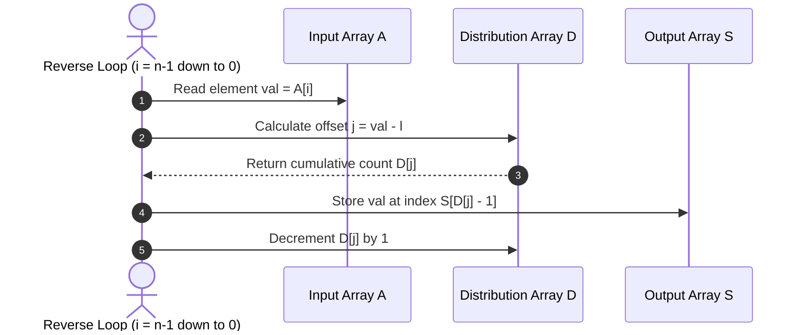

# Distribution Counting Sort — Comprehensive Algorithm Project & Analysis

[](https://colab.research.google.com/github/jonkolp/DistributionCountingSort-Algo-Project-/blob/main/DistributionCountingSort.ipynb)
[](https://www.python.org/)
[](https://youtu.be/ppD1Fg3g3nM)
[](#theoretical-foundations)
[-brightgreen.svg)](#mathematical-complexity-analysis)
[-yellow.svg)](#space-complexity)
[](#stability-analysis--proof)

An in-depth algorithm design and analysis project on **Distribution Counting Sort**, exploring non-comparison integer sorting, space-and-time trade-offs, cumulative prefix distribution, stability preservation, rigorous asymptotic proofs, and practical implementation in Python.

---

## 📑 Table of Contents

1. [Project Overview & Core Problem](#-project-overview--core-problem)
2. [Theoretical Foundations](#-theoretical-foundations)
   - [Comparison vs. Non-Comparison Sorting](#comparison-vs-non-comparison-sorting)
   - [The Space-and-Time Trade-off Paradigm](#the-space-and-time-trade-off-paradigm)
   - [Distribution Counting vs. Direct Comparison](#distribution-counting-vs-direct-comparison)
3. [Algorithm Specification](#-algorithm-specification)
   - [Formal Mathematical Definition](#formal-mathematical-definition)
   - [Variable Glossary](#variable-glossary)
   - [Pseudocode](#pseudocode)
4. [Step-by-Step Visual Execution Walkthrough](#-step-by-step-visual-execution-walkthrough)
   - [Phase 1: Frequency Histogram Construction](#phase-1-frequency-histogram-construction)
   - [Phase 2: Prefix Sum Distribution Calculation](#phase-2-prefix-sum-distribution-calculation)
   - [Phase 3: Backward Distribution Placement](#phase-3-backward-distribution-placement)
   - [Complete Iteration-by-Iteration Trace Table](#complete-iteration-by-iteration-trace-table)
5. [Mathematical Complexity Analysis](#-mathematical-complexity-analysis)
   - [Exact Basic Operations Count](#exact-basic-operations-count)
   - [Time Complexity Derivation](#time-complexity-derivation)
   - [Space Complexity](#space-complexity)
   - [Boundary & Extreme Scenario Analysis](#boundary--extreme-scenario-analysis)
6. [Stability Analysis & Formal Proof](#-stability-analysis--formal-proof)
   - [Why Stability Matters](#why-stability-matters)
   - [Mathematical Proof of Stability via Backward Scanning](#mathematical-proof-of-stability-via-backward-scanning)
   - [Why Forward Scanning Breaks Stability](#why-forward-scanning-breaks-stability)
7. [Comparative Analysis](#-comparative-analysis)
   - [Algorithm Comparison Matrix](#algorithm-comparison-matrix)
   - [When to Use and When NOT to Use](#when-to-use-and-when-not-to-use)
8. [Python Implementation & Code Architecture](#-python-implementation--code-architecture)
   - [Baseline Implementation (from Notebook)](#baseline-implementation-from-notebook)
   - [Enhanced Implementation (Negative Numbers & Dynamic Bounds)](#enhanced-implementation-negative-numbers--dynamic-bounds)
   - [Object / Key-Function Sorting (Stability Demonstration)](#object--key-function-sorting-stability-demonstration)
9. [Automated Verification & Unit Tests](#-automated-verification--unit-tests)
10. [Repository File Breakdown](#-repository-file-breakdown)
11. [Video Presentation & Demonstration](#-video-presentation--demonstration)
12. [Quickstart & Execution Guide](#-quickstart--execution-guide)
13. [Academic References & Citation](#-academic-references--citation)

---

## 🎯 Project Overview & Core Problem

A foundational theorem in computer science states that any general-purpose sorting algorithm based solely on key comparisons requires at least $\lceil\log_2(n!)\rceil \approx \Omega(n \log n)$ comparisons in the worst and average cases.

> **Central Research Question:**
> *Can we beat the $\Omega(n \log n)$ theoretical lower bound and sort elements in strictly linear time $\Theta(n)$?*

**Yes.** By utilizing extra memory to exploit key properties (specifically, when elements are discrete integers or categorical keys drawn from a bounded range $[l, u]$), **Distribution Counting Sort** bypasses comparison-based constraints entirely.

This project delivers:
- An academic presentation of the algorithm's mechanics and proofs.
- An interactive Python implementation available in Jupyter Notebook and Google Colab.
- A 44-slide presentation deck detailing the trace of each array state.
- A video lecture presented by **Youssef Ahmed Hany Abdelrehim**.

---

## 🏛 Theoretical Foundations

### Comparison vs. Non-Comparison Sorting

```
Sorting Algorithms
├── Comparison-Based (Lower bound: Ω(n log n))
│   ├── QuickSort (Avg: O(n log n), Worst: O(n²))
│   ├── MergeSort (Worst: O(n log n))
│   ├── HeapSort  (Worst: O(n log n))
│   └── InsertionSort / BubbleSort (Worst: O(n²))
│
└── Non-Comparison / Distribution-Based (Linear time: O(n + k))
    ├── Distribution Counting Sort  <-- [THIS PROJECT]
    ├── Radix Sort
    └── Bucket Sort
```

Under the **decision-tree model**, a comparison sort of $n$ distinct elements requires a binary tree with $n!$ leaves. The minimum tree height $h$ is given by:

$$h \ge \log_2(n!) = \sum_{i=1}^n \log_2 i \ge \int_1^n \log_2 x \, dx = n \log_2 n - n \log_2 e \in \Omega(n \log n)$$

Non-comparison algorithms like Distribution Counting Sort do not compare keys against each other. Instead, they inspect the mathematical identity (magnitude and frequency) of each key directly to calculate its exact sorted position.

### The Space-and-Time Trade-off Paradigm

Distribution Counting Sort is a classic embodiment of the **Space-and-Time Trade-off** principle (specifically *Input Enhancement*):
1. **Extra Space:** We allocate a frequency array $D$ of size $k = u - l + 1$ and an output array $S$ of size $n$.
2. **Time Saved:** The sorting process requires only four linear passes: initializing $D$, counting occurrences, accumulating prefix sums, and distributing keys into $S$. No nested iterations or key-to-key comparisons are ever performed.

### Distribution Counting vs. Direct Comparison

Unlike elementary "comparison counting" (which counts how many elements are smaller than $A[i]$ by comparing $A[i]$ with every other element in $O(n^2)$ time), **Distribution Counting** tabulates frequencies into index-mapped bins in $O(n)$ time, then transforms frequencies into a cumulative distribution table in $O(k)$ time.

---

## 📝 Algorithm Specification

### Formal Mathematical Definition

Given an input array $A[0 \dots n-1]$ of integers where every element satisfies:
$$l \le A[i] \le u, \quad \forall i \in \{0, 1, \dots, n-1\}$$

We define:
- Range of values: $k = u - l + 1$
- Offset mapping function: $f(x) = x - l$, which bijectively maps each value $x \in [l, u]$ to an index $j \in [0, k-1]$.
- Output array: $S[0 \dots n-1]$ such that $S[0] \le S[1] \le \dots \le S[n-1]$ is a permutation of $A$.

### Variable Glossary

| Variable | Type | Purpose | Size / Range |
|---|---|---|---|
| `A` | Array of `int` | Original unsorted input sequence | Length $n$ |
| `l` | `int` | Lower bound (minimum possible value in $A$) | Constant |
| `u` | `int` | Upper bound (maximum possible value in $A$) | Constant |
| `n` | `int` | Total number of elements in the array | $n = \text{len}(A)$ |
| `k` | `int` | Span of distinct integer values | $k = u - l + 1$ |
| `D` | Array of `int` | Dual-purpose: Frequency table $\to$ Cumulative distribution array | Length $k$ |
| `S` | Array of `int` | Auxiliary output array holding the sorted elements | Length $n$ |
| `i` | `int` | Loop index iterating over elements of $A$ and $S$ | $0 \le i < n$ |
| `j` | `int` | Offset index within the distribution array $D$ | $0 \le j < k$ |

### Pseudocode

```text
ALGORITHM DistributionCountingSort(A[0..n-1], l, u)
// Sorts an array of integers from a known range [l, u]
// Input:  An array A[0..n-1] of integers between l and u (l <= u)
// Output: An array S[0..n-1] of elements of A sorted in nondecreasing order

n <- length(A)
k <- u - l + 1

// Phase 1: Initialize frequency array
for j <- 0 to k - 1 do
    D[j] <- 0

// Phase 2: Compute frequencies (histogram)
for i <- 0 to n - 1 do
    D[A[i] - l] <- D[A[i] - l] + 1

// Phase 3: Compute cumulative distribution (prefix sums)
for j <- 1 to k - 1 do
    D[j] <- D[j] + D[j - 1]

// Phase 4: Distribute elements into output array (right-to-left scan)
for i <- n - 1 down to 0 do
    j <- A[i] - l
    S[D[j] - 1] <- A[i]
    D[j] <- D[j] - 1

return S
```

---

## 🔍 Step-by-Step Visual Execution Walkthrough

Let us trace the exact test case presented in the repository and video:
$$A = [6, 1, 1, 3, 2, 4, 5, 5, 1, 2, 3]$$

- **Array length:** $n = 11$
- **Lower bound:** $l = 1$
- **Upper bound:** $u = 6$
- **Range ($k$):** $u - l + 1 = 6 - 1 + 1 = 6$
- **Index map:** Value $v \implies \text{Index } j = v - 1$

```
Index:    0   1   2   3   4   5   6   7   8   9  10
A:      [ 6,  1,  1,  3,  2,  4,  5,  5,  1,  2,  3 ]
```

---

### Phase 1: Frequency Histogram Construction

Initialize $D[0 \dots 5] = [0, 0, 0, 0, 0, 0]$.  
Iterate $i = 0 \to 10$, incrementing $D[A[i] - 1]$ for each occurrence:

| Value ($v$) | Offset Index ($j = v - 1$) | Matching Elements in $A$ | Final Frequency $D[j]$ |
|:---:|:---:|:---|:---:|
| **1** | 0 | $A[1], A[2], A[8]$ | **3** |
| **2** | 1 | $A[4], A[9]$ | **2** |
| **3** | 2 | $A[3], A[10]$ | **2** |
| **4** | 3 | $A[5]$ | **1** |
| **5** | 4 | $A[6], A[7]$ | **2** |
| **6** | 5 | $A[0]$ | **1** |

**Frequency Array State:**
$$D = [3, 2, 2, 1, 2, 1]$$

---

### Phase 2: Prefix Sum Distribution Calculation

Compute cumulative counts using $D[j] \leftarrow D[j] + D[j - 1]$ for $j = 1 \dots 5$:

- $j = 1: D[1] = D[1] + D[0] = 2 + 3 = 5$
- $j = 2: D[2] = D[2] + D[1] = 2 + 5 = 7$
- $j = 3: D[3] = D[3] + D[2] = 1 + 7 = 8$
- $j = 4: D[4] = D[4] + D[3] = 2 + 8 = 10$
- $j = 5: D[5] = D[5] + D[4] = 1 + 10 = 11$

**Distribution Array State:**
$$D = [3, 5, 7, 8, 10, 11]$$

```
Meaning of D[j]:
- D[0] = 3   --> 3 elements are <= 1  (placed in S[0..2])
- D[1] = 5   --> 5 elements are <= 2  (placed in S[0..4])
- D[2] = 7   --> 7 elements are <= 3  (placed in S[0..6])
- D[3] = 8   --> 8 elements are <= 4  (placed in S[0..7])
- D[4] = 10  --> 10 elements are <= 5 (placed in S[0..9])
- D[5] = 11  --> 11 elements are <= 6 (placed in S[0..10])
```

---

### Phase 3: Backward Distribution Placement

Scan $A$ in reverse order from $i = 10$ down to $0$.  
For each element, look up its target slot in $S$ as $D[A[i] - l] - 1$, write the element, and decrement $D[A[i] - l]$.



---

### Complete Iteration-by-Iteration Trace Table

Below is the complete state change across all 11 iterations:

| Iteration ($i$) | Element $A[i]$ | Offset $j = A[i] - 1$ | Current $D[j]$ | Placement Index $D[j]-1$ | Updated $D$ Array | Output Array State $S$ |
|:---:|:---:|:---:|:---:|:---:|:---|:---|
| — | — | — | — | — | `[3, 5, 7, 8, 10, 11]` | `[ _, _, _, _, _, _, _, _, _, _, _ ]` |
| **$i = 10$** | **3** | 2 | 7 | **$S[6]$** | `[3, 5, 6, 8, 10, 11]` | `[ _, _, _, _, _, _, 3, _, _, _, _ ]` |
| **$i = 9$** | **2** | 1 | 5 | **$S[4]$** | `[3, 4, 6, 8, 10, 11]` | `[ _, _, _, _, 2, _, 3, _, _, _, _ ]` |
| **$i = 8$** | **1** | 0 | 3 | **$S[2]$** | `[2, 4, 6, 8, 10, 11]` | `[ _, _, 1, _, 2, _, 3, _, _, _, _ ]` |
| **$i = 7$** | **5** | 4 | 10 | **$S[9]$** | `[2, 4, 6, 8, 9, 11]` | `[ _, _, 1, _, 2, _, 3, _, _, 5, _ ]` |
| **$i = 6$** | **5** | 4 | 9 | **$S[8]$** | `[2, 4, 6, 8, 8, 11]` | `[ _, _, 1, _, 2, _, 3, _, 5, 5, _ ]` |
| **$i = 5$** | **4** | 3 | 8 | **$S[7]$** | `[2, 4, 6, 7, 8, 11]` | `[ _, _, 1, _, 2, _, 3, 4, 5, 5, _ ]` |
| **$i = 4$** | **2** | 1 | 4 | **$S[3]$** | `[2, 3, 6, 7, 8, 11]` | `[ _, _, 1, 2, 2, _, 3, 4, 5, 5, _ ]` |
| **$i = 3$** | **3** | 2 | 6 | **$S[5]$** | `[2, 3, 5, 7, 8, 11]` | `[ _, _, 1, 2, 2, 3, 3, 4, 5, 5, _ ]` |
| **$i = 2$** | **1** | 0 | 2 | **$S[1]$** | `[1, 3, 5, 7, 8, 11]` | `[ _, 1, 1, 2, 2, 3, 3, 4, 5, 5, _ ]` |
| **$i = 1$** | **1** | 0 | 1 | **$S[0]$** | `[0, 3, 5, 7, 8, 11]` | `[ 1, 1, 1, 2, 2, 3, 3, 4, 5, 5, _ ]` |
| **$i = 0$** | **6** | 5 | 11 | **$S[10]$** | `[0, 3, 5, 7, 8, 10]` | `[ 1, 1, 1, 2, 2, 3, 3, 4, 5, 5, 6 ]` |

**Final Sorted Result:**
$$S = [1, 1, 1, 2, 2, 3, 3, 4, 5, 5, 6]$$

---

## 📐 Mathematical Complexity Analysis

### Exact Basic Operations Count

Let:
- $n = \text{size of input array } A$
- $k = u - l + 1 = \text{range of key values}$

The algorithm comprises four discrete loops without nesting:

1. **Loop 1 (Initialize array $D$ of size $k$ to zero):**
   $$C_1(k) = \sum_{j=0}^{k-1} 1 = k$$

2. **Loop 2 (Compute frequencies over $A$ of size $n$):**
   $$C_2(n) = \sum_{i=0}^{n-1} 1 = n$$

3. **Loop 3 (Compute prefix sum distributions across $k$ bins):**
   $$C_3(k) = \sum_{j=1}^{k-1} 1 = k - 1$$

4. **Loop 4 (Place elements into $S$ and decrement $D$ across $n$ elements):**
   $$C_4(n) = \sum_{i=0}^{n-1} 1 = n$$

Summing the exact operations across all loops:

$$C_{\text{total}}(n, k) = C_1(k) + C_2(n) + C_3(k) + C_4(n)$$

$$C_{\text{total}}(n, k) = k + n + (k - 1) + n = 2n + 2k - 1$$

### Time Complexity Derivation

Since every step inside each loop executes in constant time $O(1)$:

$$T(n, k) \in \Theta(n + k)$$

```
+-------------------------------------------------------------+
| Best-Case Time Complexity:    Θ(n + k)                      |
| Average-Case Time Complexity: Θ(n + k)                      |
| Worst-Case Time Complexity:   Θ(n + k)                      |
+-------------------------------------------------------------+
```

Notice that the time complexity is **deterministic and invariant** to the permutation of input keys. Whether the input is sorted, reverse-sorted, or randomly shuffled, the algorithm executes the exact same operations.

### Space Complexity

The algorithm is **not in-place**; it utilizes auxiliary storage:
- **Array $D$:** Stores $k$ integer counters $\implies \Theta(k)$ memory.
- **Array $S$:** Stores $n$ output elements $\implies \Theta(n)$ memory.

$$\text{Total Space Complexity} = \Theta(n + k)$$

### Boundary & Extreme Scenario Analysis

The relationship between $k$ and $n$ dictates real-world viability:

| Regime | Condition | Time Complexity | Memory Impact | Practical Suitability |
|---|:---:|:---:|:---:|---|
| **Dense / Bounded Range** | $k \le O(n)$ | $\Theta(n)$ | Minimal | **Ideal.** Significantly faster than QuickSort / MergeSort. |
| **Fixed Small Alphabet** | $k = O(1)$ | $\Theta(n)$ | Negligible | **Optimal.** Perfect for ASCII characters, exam letter grades, etc. |
| **Sparse Range** | $k = O(n \log n)$ | $\Theta(n \log n)$ | Moderate | Equivalent asymptotic speed to comparison sorts, but with extra memory. |
| **Pathological Range** | $k \gg n$ | $\Theta(k)$ | **Catastrophic** | **Failure mode.** E.g., sorting $A = [1, 10^9]$ requires allocating an array $D$ of 1,000,000,000 integers to sort just 2 numbers. |

---

## 🔒 Stability Analysis & Formal Proof

### Why Stability Matters

A sorting algorithm is defined as **stable** if elements with identical keys appear in the output array in the exact same relative order as they were presented in the input array.

Stability is crucial when:
- Sorting composite records by multiple keys (e.g., sorting users by "Last Name", then stably sorting them by "Country").
- Implementing multi-digit **Radix Sort**, which strictly relies on an underlying stable sub-sort for each digit position.

### Mathematical Proof of Stability via Backward Scanning

Let $A[p]$ and $A[q]$ be two identical keys in input array $A$ such that:
$$A[p] = A[q] = v \quad \text{with} \quad p < q$$

We must prove that in sorted array $S$, element $A[p]$ is placed at an index strictly smaller than element $A[q]$:

$$\text{pos}(A[p]) < \text{pos}(A[q])$$

**Proof:**
1. Both elements map to the exact same offset index $j = v - l$ in distribution array $D$.
2. In Phase 4, the algorithm scans array $A$ **backwards** ($i = n - 1$ down to $0$).
3. Because $p < q$, the loop encounters index $q$ **before** index $p$.
4. When index $q$ is processed, let $D[j] = d$.
   The element $A[q]$ is placed at position:
   $$\text{pos}(A[q]) = d - 1$$
   The counter is then decremented: $D[j] \leftarrow d - 1$.
5. When index $p$ is subsequently processed, the counter has decreased to at most $d - 1$.
   The element $A[p]$ is placed at position:
   $$\text{pos}(A[p]) = (d - 1) - 1 = d - 2$$
6. Since $d - 2 < d - 1$:
   $$\text{pos}(A[p]) < \text{pos}(A[q])$$

$\blacksquare$ **Conclusion:** The relative order of equal keys is preserved. The algorithm is **strictly stable**.

### Why Forward Scanning Breaks Stability

If Phase 4 scanned forward ($i = 0$ to $n - 1$) with the same placement logic, $A[p]$ would be assigned slot $d - 1$ and $A[q]$ would be assigned slot $d - 2$, inverting their relative order and making the sort **unstable**.

---

## 📊 Comparative Analysis

### Algorithm Comparison Matrix

| Sorting Algorithm | Best Time | Average Time | Worst Time | Space | In-Place? | Stable? | Comparison-Based? |
|---|:---:|:---:|:---:|:---:|:---:|:---:|:---:|
| **Distribution Counting Sort** | $\mathbf{\Theta(n + k)}$ | $\mathbf{\Theta(n + k)}$ | $\mathbf{\Theta(n + k)}$ | $\mathbf{\Theta(n + k)}$ | ❌ No | ✅ Yes | ❌ No |
| **Standard Counting Sort** | $\Theta(n + k)$ | $\Theta(n + k)$ | $\Theta(n + k)$ | $\Theta(n + k)$ | ❌ No | ✅ Yes | ❌ No |
| **QuickSort** | $\Theta(n \log n)$ | $\Theta(n \log n)$ | $\Theta(n^2)$ | $O(\log n)$ | ✅ Yes | ❌ No | ✅ Yes |
| **MergeSort** | $\Theta(n \log n)$ | $\Theta(n \log n)$ | $\Theta(n \log n)$ | $\Theta(n)$ | ❌ No | ✅ Yes | ✅ Yes |
| **HeapSort** | $\Theta(n \log n)$ | $\Theta(n \log n)$ | $\Theta(n \log n)$ | $\Theta(1)$ | ✅ Yes | ❌ No | ✅ Yes |
| **InsertionSort** | $\Theta(n)$ | $\Theta(n^2)$ | $\Theta(n^2)$ | $\Theta(1)$ | ✅ Yes | ✅ Yes | ✅ Yes |
| **Radix Sort** | $\Theta(d(n + k))$ | $\Theta(d(n + k))$ | $\Theta(d(n + k))$ | $\Theta(n + k)$ | ❌ No | ✅ Yes | ❌ No |

### When to Use and When NOT to Use

#### ✅ When to Use
- Input keys are integers or discrete enumerable items.
- The key range $k = \max(A) - \min(A) + 1$ is known and $k \in O(n)$.
- You need a guaranteed linear-time $\Theta(n)$ sort without worst-case degradation.
- Stability is required for secondary ordering or multi-pass Radix Sort.

#### ❌ When NOT to Use
- Elements are continuous floating-point numbers (use **Bucket Sort** instead).
- Key range $k \gg n$ (e.g. 64-bit cryptographic hashes; use **QuickSort** or **MergeSort**).
- Memory is severely restricted and an in-place sort with $O(1)$ auxiliary space is required (use **HeapSort**).

---

## 💻 Python Implementation & Code Architecture

### Baseline Implementation (from Notebook)

This is the exact implementation included in [`DistributionCountingSort.ipynb`](file:///c:/Users/LOQ/Desktop/general/DistributionCountingSort.ipynb):

```python
def DistributionCountingSort(A, l, u):
    """
    Sorts an array A of integers with values between l and u 
    using the Distribution Counting Sort algorithm.
    
    Parameters:
        A (list[int]): Input array to be sorted
        l (int): Minimum possible key value (lower bound)
        u (int): Maximum possible key value (upper bound)
        
    Returns:
        list[int]: New array S containing elements of A in nondecreasing order
    """
    n = len(A)
    D = [0] * (u - l + 1)
    S = [0] * n

    # Phase 1: Initialize frequency array
    for j in range(u - l + 1):
        D[j] = 0

    # Phase 2: Compute frequencies
    for i in range(n):
        D[A[i] - l] += 1

    # Phase 3: Compute cumulative distribution
    for j in range(1, u - l + 1):
        D[j] += D[j - 1]

    # Phase 4: Distribute elements into output array (stable reverse placement)
    for i in range(n - 1, -1, -1):
        j = A[i] - l
        S[D[j] - 1] = A[i]
        D[j] -= 1

    return S


# Example Execution:
if __name__ == "__main__":
    A = [6, 1, 1, 3, 2, 4, 5, 5, 1, 2, 3]
    l = min(A)
    u = max(A)
    sorted_A = DistributionCountingSort(A, l, u)
    print("Original array: ", A)
    print("Sorted array:   ", sorted_A)
```

---

### Enhanced Implementation (Negative Numbers & Dynamic Bounds)

In practical scenarios, arrays may contain negative integers, and bounds can be automatically inferred:

```python
def distribution_counting_sort_robust(A):
    """
    Robust distribution counting sort supporting empty arrays, single elements,
    and arrays with negative numbers. Automatically discovers bounds l and u.
    """
    if not A:
        return []
    
    l = min(A)
    u = max(A)
    k = u - l + 1
    n = len(A)

    # 1. Frequency histogram
    D = [0] * k
    for x in A:
        D[x - l] += 1

    # 2. Cumulative distribution (prefix sum)
    for j in range(1, k):
        D[j] += D[j - 1]

    # 3. Output array distribution
    S = [0] * n
    for i in range(n - 1, -1, -1):
        x = A[i]
        j = x - l
        S[D[j] - 1] = x
        D[j] -= 1

    return S
```

---

### Object / Key-Function Sorting (Stability Demonstration)

To demonstrate **stability**, we sort records (e.g. students with names and numerical scores):

```python
class Student:
    def __init__(self, name: str, score: int):
        self.name = name
        self.score = score

    def __repr__(self):
        return f"{self.name} ({self.score})"


def distribution_counting_sort_objects(records, key_func, min_key, max_key):
    """
    Stably sorts a list of arbitrary objects using a numerical key extractor.
    """
    if not records:
        return []

    l, u = min_key, max_key
    k = u - l + 1
    n = len(records)

    D = [0] * k
    for item in records:
        D[key_func(item) - l] += 1

    for j in range(1, k):
        D[j] += D[j - 1]

    S = [None] * n
    for i in range(n - 1, -1, -1):
        item = records[i]
        j = key_func(item) - l
        S[D[j] - 1] = item
        D[j] -= 1

    return S


# Stability verification demonstration:
students = [
    Student("Alice", 2),
    Student("Bob", 1),
    Student("Charlie", 2),
    Student("Diana", 1),
]

sorted_students = distribution_counting_sort_objects(
    students, key_func=lambda s: s.score, min_key=1, max_key=2
)

# Output: [Bob (1), Diana (1), Alice (2), Charlie (2)]
# Notice Alice preceded Charlie in input, and still precedes Charlie in output!
print("Stably Sorted Students:", sorted_students)
```

---

## 🧪 Automated Verification & Unit Tests

The test suite covers edge cases, stability, negative integers, and randomized stress verification:

```python
import unittest
import random

class TestDistributionCountingSort(unittest.TestCase):

    def test_repo_example(self):
        A = [6, 1, 1, 3, 2, 4, 5, 5, 1, 2, 3]
        expected = sorted(A)
        self.assertEqual(DistributionCountingSort(A, min(A), max(A)), expected)

    def test_single_element(self):
        self.assertEqual(DistributionCountingSort([42], 42, 42), [42])

    def test_all_identical_elements(self):
        A = [7, 7, 7, 7, 7]
        self.assertEqual(DistributionCountingSort(A, 7, 7), [7, 7, 7, 7, 7])

    def test_already_sorted(self):
        A = [1, 2, 3, 4, 5]
        self.assertEqual(DistributionCountingSort(A, 1, 5), [1, 2, 3, 4, 5])

    def test_reverse_sorted(self):
        A = [5, 4, 3, 2, 1]
        self.assertEqual(DistributionCountingSort(A, 1, 5), [1, 2, 3, 4, 5])

    def test_negative_numbers(self):
        A = [-5, -1, -3, 0, 2, -1, 2]
        expected = sorted(A)
        self.assertEqual(DistributionCountingSort(A, -5, 2), expected)

    def test_random_large_array(self):
        for _ in range(20):
            A = [random.randint(10, 100) for _ in range(500)]
            self.assertEqual(DistributionCountingSort(A, 10, 100), sorted(A))

if __name__ == "__main__":
    unittest.main()
```

---

## 📁 Repository File Breakdown

| File Name | Format | Description |
|---|:---:|---|
| **`DistributionCountingSort.ipynb`** | Jupyter Notebook | Complete interactive Python implementation with live outputs, Colab badges, and executable example blocks. |
| **`Distribution Counting Sort.pptx`** | PowerPoint | 44 beautifully structured presentation slides detailing the motivation, step-by-step array transitions, code snippet, and mathematical proofs. |
| **`Algo Project (1).pdf`** | PDF Document | Visual architectural diagram illustrating the mapping between input array, frequency array, cumulative distribution, and sorted output array. |
| **`README.md`** | Markdown | Full documentation, mathematical derivation, proofs, and execution guide. |

---

## 🎥 Video Presentation & Demonstration

The video presentation walks through every slide of the project deck, providing clear auditory explanations and dynamic visualizations of array transformations.

[](https://youtu.be/ppD1Fg3g3nM)

- **Video URL:** [https://youtu.be/ppD1Fg3g3nM](https://youtu.be/ppD1Fg3g3nM)
- **Presenter:** Youssef Ahmed Hany Abdelrehim
- **Language:** Arabic with English technical terminology and slides
- **Duration & Content:** Thorough walkthrough of the problem motivation, frequency calculation, cumulative array accumulation, reverse placement demonstration, and full asymptotic derivation of $\Theta(n + k)$.

---

## 🚀 Quickstart & Execution Guide

### Option 1: Run in Google Colab (Zero Installation)

Click the link below to open the notebook directly in your browser:

[](https://colab.research.google.com/github/jonkolp/DistributionCountingSort-Algo-Project-/blob/main/DistributionCountingSort.ipynb)

### Option 2: Run Locally via Git & Jupyter

1. **Clone the repository:**
   ```bash
   git clone https://github.com/jonkolp/DistributionCountingSort-Algo-Project-.git
   cd DistributionCountingSort-Algo-Project-
   ```

2. **Launch Jupyter:**
   ```bash
   jupyter notebook DistributionCountingSort.ipynb
   ```

3. **Or run standalone Python code:**
   ```bash
   python -c "
   def DistributionCountingSort(A, l, u):
       n, k = len(A), u - l + 1
       D, S = [0]*k, [0]*n
       for i in range(n): D[A[i] - l] += 1
       for j in range(1, k): D[j] += D[j - 1]
       for i in range(n - 1, -1, -1):
           j = A[i] - l
           S[D[j] - 1] = A[i]
           D[j] -= 1
       return S

   data = [6, 1, 1, 3, 2, 4, 5, 5, 1, 2, 3]
   print('Sorted:', DistributionCountingSort(data, min(data), max(data)))
   "
   ```

---

## 📚 Academic References & Citation

1. **Levitin, Anany.** *Introduction to the Design and Analysis of Algorithms.* 3rd Edition, Pearson, 2012.
   - *Chapter 7: Space-and-Time Trade-Offs (Section 7.1: Sorting by Counting / Distribution Counting Sort, pp. 256–260).*
2. **Cormen, Thomas H., Leiserson, Charles E., Rivest, Ronald L., & Stein, Clifford.** *Introduction to Algorithms (CLRS).* 4th Edition, MIT Press, 2022.
   - *Chapter 8: Sorting in Linear Time (Section 8.2: Counting Sort).*
3. **Knuth, Donald E.** *The Art of Computer Programming, Volume 3: Sorting and Searching.* 2nd Edition, Addison-Wesley, 1998.
   - *Section 5.2: Internal Sorting (Distribution Counting).*

---

### Author & Maintainer
- **Youssef Ahmed Hany Abdelrehim** — [GitHub Profile (@jonkolp)](https://github.com/jonkolp)
- **YouTube Channel:** [Video Walkthrough](https://youtu.be/ppD1Fg3g3nM)
